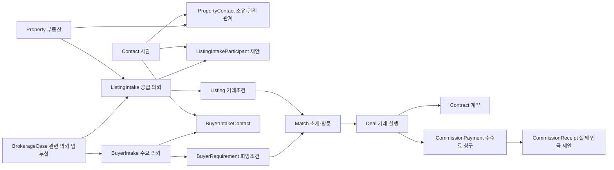

# 부동산 중개사무소 ERP 스키마 적합성 검토

검토일: 2026-09-14. 체크아웃: `/Users/hyunsulee/estate-erp`, HEAD `a35915d`.

## 판단과 범위

현재 구조는 **아파트·오피스텔 중심 중개사무소의 매물 접수 → 고객 상담 → 매칭 → 계약 업무에 적합한 기반**이다. 특히 부동산 자체, 접수 회차, 거래조건, 거래 진행, 계약 문서를 구분한 방향을 유지하는 것이 좋다.

다만 **의뢰별 참여자·담당자, 업무철의 경계, 실제 수금 이력, 사무소 간 관계 무결성**은 우선 보완해야 한다. 상가·토지까지 깊게 다루거나 임대인의 월별 임대료 수납·시설관리까지 수행하려면 별도 확장이 필요하다.

사용자의 이번 요청에는 상세 업무 우선순위가 없으므로, 저장소 PRD의 “여러 직원이 일하는 대한민국 중개사무소 ERP”를 평가 기준으로 삼았다. 아래 개선안은 제안이며 확정된 제품 결정이 아니다.

- 현재 Prisma 정의는 안내 문서의 `prisma/schema.prisma`가 아니라 `prisma/schema/` 아래 21개 파일, 70개 모델이다. 모델 수는 실제 운영 DB 테이블 수를 조회한 결과가 아니다.
- PRD, DATA_STRUCTURE, DECISIONS, 현재 모델, SQL 마이그레이션 및 주요 서버 생성·상태전이·수금 경로를 검토했다.
- 실제 운영 DB의 마이그레이션 적용 여부, 데이터 중복·누출 발생 여부, 화면 동작과 성능은 검증하지 않았다.
- 코드·스키마·DB는 변경하지 않았고, 이 분석 문서만 추가했다. 기존 작업 파일은 유지했다.

## 1. 유지할 핵심 구조

| 구분 | 현재 모델 | 업무상 의미와 평가 |
|---|---|---|
| 물리적 부동산 | Site → Dong → Unit | 단지·동·호실 및 평형 카탈로그 구분. 아파트 관리에 적합 |
| 사무소의 관리 대상 | Property | 매물로 나오기 전·거래 종료 후에도 소유자와 세입자 관리 가능 |
| 공급 의뢰 | ListingIntake → Listing | 접수 회차와 매매·전세·월세 대안을 구분. 같은 집의 거래조건을 여러 개 제시 가능 |
| 수요 의뢰 | BuyerIntake → BuyerRequirement | 부부·공동매수인 참여와 복수 희망조건을 구분 |
| 연계 업무 | BrokerageCase / Dependency | 기존 집 매각대금으로 새집 구매 같은 갈아타기 관계를 표현 가능 |
| 중개 진행 | Match → Deal | 소개·방문과 실제 거래 실행을 구분 |
| 계약 | Contract / ContractParty / ContractDocument / Revision | 공동명의·대리인·복수 서식·문서 버전을 표현 |
| 돈의 성격 | DealPayment / CommissionPayment / CommissionDistribution | 거래대금, 중개수수료, 사무소 간 분배를 구분 |
| 광고 | ListingAdvertisement / PriceHistory / SnapshotSession | 원장 가격과 외부 게재 가격, 재광고 회차 및 관측 시점을 구분 |
| 공동중개망 | NetworkRoom / SharedProperty / Inquiry | 방 가입과 매물별 공개 범위를 구분 |

특히 ListingIntake의 생명주기와 유효성 확인, Listing의 옵션별 보류, Deal에서 파생되는 거래 가능 상태를 나눈 점은 타당하다. 모든 상태를 단일 `status` 필드로 되돌릴 이유가 없다.

마이그레이션에도 이미 보호장치가 있다. “부동산당 open/hold 의뢰 하나”, 의뢰별 대표 연락창구, 업무철 의존관계의 동일 사무소·업무철 FK가 대표적이다. `unitId=null`인 Property의 중복 역시 별도 partial unique index로 보완돼 있다. Prisma 파일만 읽고 이 제약들이 없다고 판단하면 안 된다.

근거: [매물 모델](../prisma/schema/property.prisma), [CRM 모델](../prisma/schema/crm.prisma), [업무철 모델](../prisma/schema/brokerage-case.prisma), [의뢰 제약](../prisma/schema/migrations/20260724120000_intake_lifecycle_confirmation_axes/migration.sql), [호실 없는 Property 고유성](../prisma/schema/migrations/20260610111135_listing_p0_fields_user_license/migration.sql).

## 2. 먼저 보완할 부분

### A. 사무소 격리가 관계 전체에서 강제되지 않는다 — 최우선

**확인한 사실**

- BuyerIntakeContact, BrokerageCaseParticipant 등은 `(officeId, id)`를 함께 참조한다.
- Match의 Listing·BuyerRequirement 연결, Tenant의 Property·Contact 연결 등은 대상의 `id`만 참조한다.
- `MatchesService.create()`는 같은 사무소 안의 중복 매칭만 조회한 뒤, 입력받은 `listingId`, `buyerReqId`로 저장한다. 두 대상의 사무소 소속을 별도로 확인하지 않는다. DTO도 UUID 형식만 검사한다.
- `TenantsService.create()`도 입력받은 Property·Contact의 소속 검증 없이 저장한다.
- Prisma 공통 확장은 명시된 모델의 최상위 쿼리에 사무소 조건을 보충한다. 이미 `officeId`가 있으면 그대로 두며, 재무 모델과 ContactPhone 등 일부 사무소 모델은 목록에 없다. 재무 서비스의 명시적 `officeId` 조건은 확인했으므로 “재무 조회 전체가 무방비”라고 판단하지는 않는다.

**업무 영향**

현재 저장소 코드와 선언된 DB 제약만으로는 A사무소의 Match가 B사무소 Listing을 참조하는 것을 막지 못한다. 저장 결과에 관계 데이터를 include하므로 참조 대상 정보가 노출될 위험도 있다. 이는 코드상 확인한 검증 공백이며, 운영 환경에서 실제 누출이 발생했다는 뜻은 아니다.

**제안**

1. 매칭·세입자 생성부터 참조 대상의 동일 사무소 여부를 검증한다.
2. 사무소 소유 관계에 복합 FK를 점진적으로 적용한다. Listing의 propertyId와 intake.propertyId가 일치하는 등의 경로 일관성도 함께 점검한다.
3. 공통 확장 대상과 누락 의도를 목록화한다. 요청 사무소와 명시 officeId가 충돌하면 거부하고, 시스템 작업은 별도 진입점으로 분리한다.
4. 공공 Site·공유 네트워크에는 각자의 공개·소유권·멤버십 규칙을 적용한다. 모든 모델에 동일 officeId 조건을 붙이면 공유 기능을 훼손한다.

Prisma 6의 query extension은 중첩 read/write를 별도로 지원하지 않는다. 따라서 현재 최상위 officeId 보충만으로 include·중첩 생성까지 격리된다고 가정할 수 없다. [Prisma 6 공식 문서](https://docs.prisma.io/docs/orm/v6/prisma-client/client-extensions)

근거: [MatchesService.create](../apps/server/src/modules/matches/matches.service.ts), [매칭 DTO](../apps/server/src/modules/matches/dto/match.dto.ts), [TenantsService](../apps/server/src/modules/tenants/tenants.service.ts), [PrismaService](../apps/server/src/prisma/prisma.service.ts).

### B. 매도 의뢰의 참여자가 독립적으로 보존되지 않는다 — 업무 모델 우선순위 1

**확인한 사실**

- BuyerIntake에는 BuyerIntakeContact가 있다.
- ListingIntake에는 의뢰인 또는 의뢰별 참여자 테이블이 없다.
- 공급 의뢰의 사람은 `Property → PropertyContact → Contact` 또는 `BrokerageCase → Participant → Contact`로 연결된다.
- 공급 의뢰 생성 시 현재 활성 PropertyContact를 읽어 케이스 참여자로 변환한다.
- 이후 관련인 변경은 케이스 참여자에 병합하며, 과거 참여자를 자동 제거하지 않는다.

**왜 문제가 되는가**

“아버지가 소유자, 딸이 이번 매도 의뢰인, 세입자가 방문 연락처”인 경우 세 역할은 서로 다르다. 부동산의 현재 관련인과 업무철 전체 참여자만으로는 **이번 접수 회차에서 누가 의뢰했고 누가 연락을 담당했는지**를 독립적으로 확정하기 어렵다. 과거 의뢰를 다시 열 때 현재 소유자·대리인 정보와 섞일 수 있다.

**제안**

`ListingIntakeContact` 또는 `ListingIntakeParticipant`를 추가해 의뢰별 역할과 주 연락창구를 보존한다. PropertyContact는 부동산의 소유·관리 관계로 유지한다. 최초 문의자와 현재 주 연락창구도 의미를 나누고, 최초 문의는 상담·접수 출처와 연결한다. 공동명의와 대리인 때문에 단일 `customerId`만 추가하는 것으로는 충분하지 않다.

근거: [ListingIntake](../prisma/schema/property.prisma), [BuyerIntakeContact](../prisma/schema/crm.prisma), [관련인·케이스 병합](../apps/server/src/modules/brokerage-cases/brokerage-case.resolver.ts).

### C. BrokerageCase가 같은 사람의 서로 다른 업무를 자동으로 묶는다

**확인한 사실**

`resolveBrokerageCaseForIntake()`는 명시적 케이스 지정이 없고 자동 연결이 켜져 있으면, 실제 당사자 집합이 정확히 같은 활성 케이스를 찾는다. 목적·대상 부동산·기간은 연결 조건이 아니다. 잠금으로 동시성은 제어하지만, 같은 고객의 독립된 업무를 구분하는 기준은 되지 않는다.

또한 케이스의 `latestConsultation`은 주 연락창구 Contact의 최근 상담 하나에서 가져오며 해당 업무철로 제한하지 않는다.

**업무 예시**

김씨의 “집을 팔고 갈아타기”와 “투자용 상가 구입”이 같은 당사자라는 이유로 한 업무철에 붙을 수 있다. 최근 상담도 다른 의뢰의 내용이 표시될 수 있다.

**제안**

- Contact는 사람, Intake는 한 번의 의뢰, Case는 관련 의뢰를 묶은 업무철로 정의한다.
- 동일 사람은 기존 케이스를 추천하는 조건으로 쓰고, 실제 연결은 명시적으로 결정한다.
- 일반 접수에서는 자동 생성된 1개 의뢰용 업무철을 내부적으로 유지하는 방식도 가능하다. 당장 모든 FK를 nullable로 바꿀 필요는 없다.
- 케이스 상담은 하위 의뢰의 상담을 집계하거나 명시적 case 문맥을 저장한다. “고객 전체 최근 상담”이라면 필드와 화면 이름도 그 의미로 표시한다.

케이스 참여자·의뢰 참여자·PropertyContact를 모두 편집 가능한 독립 원본으로 만들면 동기화 문제가 늘어난다. 케이스 참여자는 의뢰 참여자의 집계인지, 케이스만의 별도 참여자를 포함하는지 먼저 결정해야 한다.

근거: [자동 연결](../apps/server/src/modules/brokerage-cases/brokerage-case.resolver.ts), [최근 상담 조회·표현](../apps/server/src/modules/brokerage-cases/brokerage-cases.service.ts).

### D. 수수료 청구와 실제 입금 이력이 한 행에 섞여 있다 — 재무 사용 전 우선

**확인한 사실**

CommissionPayment에는 `expectedAmount`, `actualAmount`, `paidAt`이 각각 하나다. `collect()`는 actualAmount와 paidAt을 덮어쓴다. 월별 추이는 paidAt이 해당 월에 속하는 행의 actualAmount 합계다.

**구체적 결과**

100만원 청구에서 8월 30만원, 9월 70만원을 수금하고 두 번째 입력을 누계 100만원으로 저장하면, 이 구조의 월별 집계는 8월 입금 30만원을 따로 유지할 수 없다. 입력을 추가 수금액 70만원으로 해석하면 총 수금액이 누락된다. 이는 단순 표시 문제가 아니라 입금 이벤트가 없는 구조의 한계다.

**제안**

- 현재 CommissionPayment를 청구로 유지하고 `CommissionReceipt` 같은 입금 자식 모델을 둔다.
- 입금마다 금액·시각·방법·입금자·증빙·기록자를 저장한다. 취소/환불은 원거래를 참조하는 별도 이벤트로 보존한다.
- 수금 합계·미수금·부분수금 상태는 입금 및 조정의 합으로 계산한다.
- DealPayment도 예정 차수와 실제 입금 이벤트를 나눈다. 하나의 중도금 차수에 여러 번 입금하는 경우를 담아야 한다.
- OfficeExpenseTemplate은 반복 지출 예산이다. 실제 지출·월별 손익이 목표라면 비용 발생/결제 레코드가 별도로 필요하다. 현재 추이는 현재 고정비 합계를 과거 각 월에도 사용한다.

근거: [재무 모델](../prisma/schema/finance.prisma), [수금 저장](../apps/server/src/modules/finance/commission-payment.service.ts), [월별 추이](../apps/server/src/modules/finance/cashflow.service.ts), [DealPayment](../prisma/schema/crm.prisma).

### E. 만원 단위 정수는 실제 정산의 정밀도가 부족하다

만원 단위는 매물 가격 입력과 표시에 편리하다. 그러나 CommissionPayment, CommissionDistribution, DealParticipant, OfficeExpenseTemplate도 Int 만원 단위다. 예를 들어 125만원을 50% 배분한 62만 5천원은 정수 만원으로 표현할 수 없다. 관리비 5,500원 같은 금액도 같은 문제가 있다.

**제안**: 거래가격 표시 단위와 정산 저장 단위를 분리한다. 정산은 원 단위 정수 또는 정확한 Decimal을 선택하고 단위를 필드·API에 명시한다. 공급가액·세액·합계·절사 및 배분 잔액 규칙도 정한다. 기존 숫자의 단위를 제자리에서 바꾸면 안 되며, 별도 필드와 명시적 변환으로 이관해야 한다. 이 제안은 세율·법정 수수료 규정에 대한 검토가 아니다.

근거: [재무 모델](../prisma/schema/finance.prisma), [직원 정산 모델](../prisma/schema/crm.prisma).

### F. 의뢰의 담당자와 종료 후 연결이 약하다

- BuyerRequirement에는 assignedToId가 있지만 BuyerIntake, ListingIntake, BrokerageCase에는 의뢰 책임자 필드가 없다. Task 담당자와 DealParticipant는 의뢰 전체 책임자를 대신하지 못한다.
- ListingIntake에는 상세 종결 사유와 변경 시점이 있지만 BuyerIntake에는 lifecycleStatus와 updatedAt 중심으로만 저장된다.
- Deal은 buyerIntakeId를 직접 보유하지 않고 선택적 Match를 거쳐 수요 의뢰에 도달한다. 매칭 없이 시작한 거래는 어느 구매 의뢰의 결과인지 분명하지 않을 수 있다.
- Deal 완료 경로에는 공급 의뢰를 닫는 처리가 있지만 같은 경로에서 수요 의뢰의 결과나 세입자·소유 관계를 갱신하는 처리는 확인하지 못했다.
- Tenant는 계약기간과 금액을 별도로 저장하지만 Contract FK가 없다. 계약서 작성부터 입주·만기 관리까지의 근거 연결이 약하다.

**제안**: 업무 단위별 책임자·접수자·접수 출처를 정한다. 거래의 수요 의뢰 출처와 종결 근거를 보존한다. 계약 결과에서 새 소유관계·입주 예정·기존 임대차 종료를 제안하거나 확인 후 반영하는 연결을 둔다. 한 번 거래했다고 고객의 모든 구매조건을 자동 종료하면 안 된다. 복수 투자·복수 매수 의뢰를 고려해 어느 의뢰가 충족됐는지 명시한다.

근거: [CRM 모델](../prisma/schema/crm.prisma), [매물 모델](../prisma/schema/property.prisma), [Deal 상태 전이](../apps/server/src/modules/deals/deals.service.ts), [Tenant 모델](../prisma/schema/contact.prisma).

### G. 중복 방지와 감사 기록을 “있다”로만 평가하면 안 된다

**중복 방지**

- Match는 활성 중복을 먼저 조회한 다음 생성한다. 현재 모델·마이그레이션에서는 이를 강제하는 활성 쌍 unique index를 찾지 못했다. 동시 생성 시 중복 가능성이 있다.
- Dong에는 siteId+name, Unit에는 dongId+호실 식별자의 unique 제약이 없다. 생성 서비스에도 동일 이름 중복 검사가 없다. 호실은 빈칸·공용시설도 포함하므로 무조건 name을 unique로 묶기보다 실제 세대의 정규화된 식별자를 먼저 정해야 한다.

**감사 기록**

- AUDITED_MODELS와 AUDITED_OPERATIONS는 제한 목록이다. 재무 수금 모델은 목록에 없으며 collect()에 별도 감사 작성도 없다.
- `updateMany`, `createMany`는 감사 대상 연산이 아니다. 예를 들어 Deal 완료에 따른 ListingIntake.updateMany는 이 공통 감사 경로로 별도 intake 로그를 남기지 않는다.
- 업무 쓰기와 감사·가격이력 쓰기는 동일 tx 전달 방식이 아니라 확장 내부 baseClient를 사용한다. 롤백 시 업무와 이력이 함께 되돌아가는지는 DB 통합 테스트가 필요하다.

**제안**: 활성 매칭 쌍을 DB에서 고유하게 하고, 돈·상태 전이·담당자 변경 같은 중요한 이벤트는 동일 트랜잭션 안에서 이력을 보존한다. 중첩 쓰기·일괄 갱신·롤백까지 포함해 검증한다.

근거: [매칭 생성](../apps/server/src/modules/matches/matches.service.ts), [공통 감사](../apps/server/src/prisma/prisma.service.ts), [동·호 모델](../prisma/schema/site.prisma), [동 생성](../apps/server/src/modules/dongs/dongs.service.ts), [호실 생성](../apps/server/src/modules/units/units.service.ts).

## 3. 제품 범위에 따라 결정할 확장

| 요구 업무 | 현재 판단 | 확장이 필요한 경우 |
|---|---|---|
| 가족·공동명의·대리인 | 관계·의뢰 참여자·계약 당사자 기반이 좋음 | 공급 의뢰 참여자 및 역할 유효기간 보완 |
| 가족 공용 전화·법인 대표번호 | ContactPhone의 사무소+전화번호 unique는 번호당 한 Contact만 허용 | 공유 번호를 여러 사람에 연결해야 한다면 번호와 사람의 관계를 별도 모델링. 현재 중복방지·전화응대 정책의 변경이므로 먼저 제품 결정 필요 |
| 기본 구매조건 검색 | 지역·단지·가격·면적·입주일 표현 가능 | 층·방수·주차·반려동물·융자 가능 여부 등 자주 검색할 필수조건을 명시적으로 추가 |
| 상가·토지 중개 | Site.metadata와 Listing.premium 등 기초 슬롯 존재 | 용도·대지/연면적·층별 임대현황·다필지 묶음·포함 자산 등을 검색/계약에 활용하려면 타입별 검증 및 구조화 필요 |
| 공동중개망 | 가입·공유·마스킹·문의 모델 존재 | 문의에서 성사된 Deal의 출처와 공유 당시 조건을 추적하려면 명시적 참조/스냅샷 보완 |
| 임대차 사후 관리 | Tenant 만기 조회 기반 존재 | 계약·갱신 회차·입퇴거·보증금 반환 근거 연결 |
| 임대관리 사업자용 운영 | 현재 중개 CRM과 범위가 다름 | 월별 임대료 청구·연체·시설수리·검침·임대인 정산이 핵심이라면 별도 임대운영 모델 필요 |

상가·토지 지원을 위해 처음부터 모든 속성을 테이블로 만들 필요는 없다. 자주 필터링·계산·검증하는 필드는 구조화하고 드문 부가정보는 버전이 있는 JSON으로 유지하는 편이 합리적이다. 현재 BuyerRequirement 면적은 공급면적 기준이므로 자산 종류가 넓어질 때는 전용/공급/대지/연면적의 의미도 함께 정의해야 한다.

## 4. 권장 목표 구조

이 다이어그램은 핵심 의미만 나타낸다. 기존 직접 거래 생성, 외부 매물 거래, 독립 계약 서식, 문서 버전과 공동중개 분배 모델은 유지한다. 추가 모델 두 개는 현재 존재하는 모델이 아니다.

## 5. 실행 순서와 검증 시나리오

1. **사무소 경계와 관계 무결성**: Match·Tenant 생성 경로부터 동일 사무소 검증, 복합 FK, 중첩 조회·작성 검증.
2. **의뢰 중심 모델**: 공급 의뢰 참여자, 업무철 연결 정책, 의뢰 책임자와 상담 문맥.
3. **재무 원장**: 실제 입금·환불 이벤트와 금액 정밀도. 청구·분배·입금·직원 정산의 기준을 명시.
4. **업무 종결 연결**: 수요 의뢰 결과, 소유·임차 변경과 계약 출처, 갱신·만기 관리.
5. **자산 유형 확장과 문서 동기화**: 목표 고객의 실제 업무를 기준으로 상가·토지 세부 속성을 선택.

다음 시나리오를 먼저 합의하고 DB 통합 테스트의 기준으로 삼는 것이 좋다.

- 같은 집을 매매·전세로 동시에 접수하고 한 옵션의 거래 완료/취소에 따라 의뢰가 올바르게 닫히고 복원되는가.
- 소유자·의뢰인·방문 연락처가 다른 경우와 대리인이 바뀐 과거 접수 회차를 구분할 수 있는가.
- 같은 고객의 갈아타기와 별도 투자 의뢰를 분리하면서 필요한 의뢰끼리만 묶을 수 있는가.
- 다른 사무소의 ID로 매칭·세입자를 만들 수 없는가. 중첩 조회도 타 사무소 정보를 반환하지 않는가.
- 8월 30만원/9월 70만원 수금과 일부 환불이 월별 원장에 그대로 남는가.
- 매칭 동시 생성, 상태 일괄 변경, 트랜잭션 롤백에서도 중복과 잘못된 이력이 생기지 않는가.
- 거래 종료 뒤 계약 출처와 연결된 입주·만기 관리가 가능하고 다른 구매 의뢰가 잘못 닫히지 않는가.

## 6. 이번 검증 결과

- Prisma 6.19.2로 `prisma validate --schema prisma/schema` 통과. 루트에 DATABASE_URL이 없어서 비접속용 더미 URL을 지정했으며 DB 연결·스키마 적용은 하지 않았다.
- 기존 단위 테스트 3개 스위트, 36개 통과: brokerage-case.resolver, matches.service, deals.stage-sync.
- 이 테스트는 기존 동작을 확인하는 단위 테스트다. 위에서 지적한 타 사무소 참조, 동시 생성, 실제 DB 롤백, 분할 수금 문제를 재현한 통합 검증은 아니다.
- PRD·AGENTS·DATA_STRUCTURE에는 현재 모델 수·경로 및 일부 관계 설명과의 차이가 있다. 문서만으로 신규 구현을 하면 오래된 설계를 다시 도입할 수 있으므로, 위 업무 단위가 확정된 뒤 문서를 함께 갱신해야 한다.
