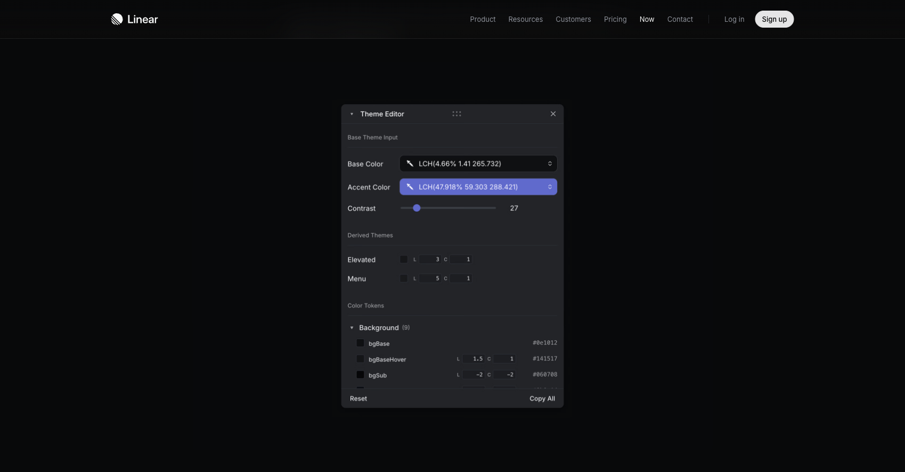
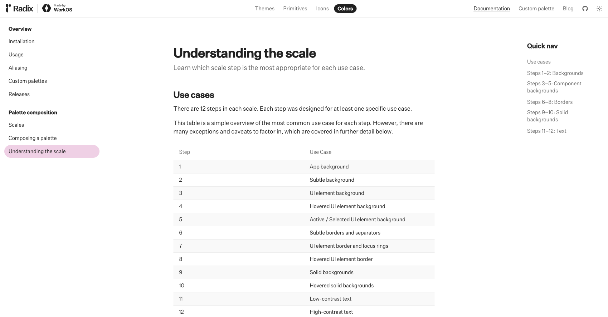

# SaaS 디자인 기준과 팔레트 구현 조사

조사일: 2026-09-15. 범위: 공식 디자인 문서·공개 제품 리디자인 사례와 현재 Estate ERP 코드. 여기서 SaaS는 서비스 UI 스타일을 뜻하며 Sass 전처리기 도입을 뜻하지 않습니다.

## 결론

디자인 문서와 팔레트를 먼저 만드는 방향이 타당합니다. 다만 문서 작성 → 곧바로 전체 화면 재구현보다는, **실제 레퍼런스 → 디자인 규칙 초안 → 역할별 토큰 → 동일 컴포넌트 비교 → 선택한 기준으로 고객원장 한 구역 적용**이 적절합니다.

`DESIGN.md`는 판단 기준, CSS 토큰은 실행되는 값, 컴포넌트는 상태와 동작입니다. 세 가지를 연결해야 같은 화면이 반복 작업마다 다른 스타일로 바뀌는 문제를 줄일 수 있습니다. 아래 방식은 공식 사례에서 얻은 원리를 Estate ERP에 맞게 해석한 제안입니다.

## 1. 웹에서 실제로 사용하는 방식

| 공식 사례 | 확인한 구현 방식 | Estate ERP에 적용할 점 |
| --- | --- | --- |
| Linear, 2026-03-12 리프레시 | 탐색 장식의 시각적 비중을 낮추고, 헤더 역할을 정리. 앱 내부에서 개별 색 토큰을 조절하고 JSON으로 Figma와 맞춤 | 외부 팔레트 색만 고르지 말고 실제 한국어 행에서 즉시 비교 |
| Vercel Geist | 컴포넌트 배경, 경계선, 진한 배경, 글자에 색 단계별 역할 부여 | 밝은 선용 회색을 보조 글자에 재사용하지 않음 |
| Radix Colors | 12단계 색에 배경·상태·경계·텍스트 용도를 정의 | 기본/hover/선택/포커스까지 포함해 팔레트 구성 |
| Atlassian | 의미 있는 토큰 이름과 공통 간격 스케일 사용 | `gray-400` 직접 사용보다 `text.secondary`, `border.input` 같은 역할 사용 |
| shadcn/ui | CSS 변수와 배경/foreground 쌍으로 테마 구성 | 현재 React·Tailwind·shadcn을 유지하며 테마 적용 가능 |
| Google DESIGN.md | YAML 토큰과 Markdown 의도를 함께 기록. 포맷은 alpha | 수치와 금지 사항을 같이 기록하고 코드 토큰과 함께 변경 |

### Linear에서 배울 핵심: 색을 고르는 장소

2026년 공식 글은 실제 앱에 색 조절 도구를 만들고, 마음에 드는 값을 JSON으로 옮겨 디자인 파일과 맞췄다고 설명합니다. 탐색부·아이콘·경계선의 무게를 줄이는 판단도 함께 했습니다. 색깔만 바꾸는 리디자인이 아닙니다. 이번 팔레트 보드도 같은 콘텐츠를 고정해 색과 밀도만 비교하도록 구성했습니다. [공식 리프레시 설명](https://linear.app/now/behind-the-latest-design-refresh)

2024년 리디자인에서도 시각적 개선과 정보구조 변경의 범위를 분리했습니다. 이는 이미 익숙한 원장의 열·정렬·접기를 유지하려는 이번 요구에 맞습니다. [공식 2024 리디자인 설명](https://linear.app/now/how-we-redesigned-the-linear-ui)



위 캡처는 공식 글에 게시된 편집기 이미지이며, Linear에 로그인해 편집기를 직접 조작한 결과가 아닙니다.

### Geist와 Radix: 회색도 역할이 있다

Geist는 배경 단계와 글자 단계를 구분합니다. Radix는 1–2를 앱 배경, 3–5를 컴포넌트 상태, 6–8을 경계, 9–10을 진한 배경, 11–12를 글자에 대응시킵니다. Radix의 단계 설명에는 예외가 있으므로 번호만으로 모든 조합의 대비가 보장된다고 해석하면 안 됩니다. [Geist Colors](https://vercel.com/geist/colors), [Radix scale](https://www.radix-ui.com/colors/docs/palette-composition/understanding-the-scale)

고객원장에서는 `text-secondary`와 `border`가 서로 다른 토큰이어야 합니다. 희미한 구분선은 괜찮아도, 연락처와 등록일이 같은 명도로 희미해지면 읽기 어려워집니다.



### Atlassian: 팔레트보다 의미와 간격

Atlassian은 토큰을 반복되는 디자인 결정을 이름과 값으로 저장하는 방식으로 설명합니다. 색의 역할·강조·상태를 구분하고, 8px 기반 간격 스케일도 운영합니다. Estate ERP 제안은 표 밀도를 고려해 4px 보조 간격을 포함한 제한된 스케일을 사용합니다. 이는 Atlassian 수치의 복제가 아닌 프로젝트용 선택입니다. [Design tokens](https://atlassian.design/tokens/design-tokens), [Color](https://atlassian.design/foundations/color), [Spacing](https://atlassian.design/foundations/spacing)

## 2. 현재 작업이 흔들린 이유

현재 저장소에는 이미 [루트 DESIGN.md](../../DESIGN.md)가 있습니다. 문제를 “디자인 문서가 없어서”라고 진단하면 틀립니다.

| 현재 근거 | 문제 | 수정 방향 |
| --- | --- | --- |
| 루트 문서의 `omitted.spacing` | 공통 간격 규칙이 의도적으로 비어 있음 | 간격·컨트롤 높이·행 높이를 명시 |
| 루트 문서는 실제 CSS를 우선한다고 명시 | 문서와 구현이 다른 경우 구현이 기준이 됨 | 확정 이후 문서·토큰을 한 변경으로 관리 |
| `app.css`에는 의미 색상이 있으나 고객원장에 별도 hex와 10–13px 값이 다수 존재 | 페이지별 예외가 디자인 시스템을 약화 | 공통 컴포넌트 상태와 토큰으로 매핑 |
| 마지막 Modern 시안에서 서로 다른 hex 리터럴 140개 확인 | 제 시안도 공통 기준보다 개별 조정에 의존 | 색을 역할별 제한된 값으로 관리 |
| Modern 시안의 일부 작은 글자 대비가 낮음 | 흐린 글자를 “모던함”으로 처리 | 핵심/보조 글자의 최저 대비를 함께 확인 |

코드 근거: [desktop app.css](../../apps/desktop/src/renderer/app.css), [고객원장 구현](../../apps/desktop/src/renderer/routes/_authenticated/customers/index.tsx), [이전 Modern 시안](../mockups/customer-ledger-modern/index.html).

코드의 불투명 sRGB 색 쌍으로 계산한 예:

| 전경 / 배경 | 대비 | 해석 |
| --- | ---: | --- |
| `#8A94A5` / `#FFFFFF` | 3.06:1 | 일반 크기 글자 4.5:1 미달 |
| `#7B899E` / `#FFFFFF` | 3.55:1 | 일반 크기 글자 4.5:1 미달 |
| `#787774` / `#F7F6F3` | 4.14:1 | 이 조합으로 쓰는 작은 글자에는 부족 |

WCAG는 일반 텍스트에 4.5:1을 요구하며 일부 큰 글자에는 3:1이 적용됩니다. 위 수치는 특정 CSS 쌍의 계산이지, 전체 앱의 접근성 판정이 아닙니다. [W3C Contrast Minimum](https://www.w3.org/WAI/WCAG22/Understanding/contrast-minimum.html)

## 3. 먼저 결정할 디자인 축

우선순위는 아래와 같습니다. 팔레트를 결정해도 나머지를 매번 바꾸면 같은 문제가 반복됩니다.

1. **표현:** 선명한 원장 / 부드러운 업무 도구 / 차가운 SaaS 도구 중 선택.
2. **밀도:** 본문 14px·행 44px를 기준으로 13–15px, 40–48px를 동일 데이터에서 비교.
3. **중립색:** Neutral / Warm / Slate 중 하나만 사용.
4. **강조색:** 주요 실행·선택·초점·업무 상태의 의미를 구분.
5. **형태:** 반경 4/6/8px, 기본 표면 무그림자, 오버레이에만 그림자.
6. **배치:** 현재 고객 묶음·의뢰 행·원장 열을 유지. 정렬과 필터를 제거하지 않음.

“Linear처럼”, “모던하게”는 참고 방향으로만 사용하고, 실제 값·컴포넌트 표본으로 합의해야 합니다. 영문 개발도구의 작은 글자 밀도를 한국어 부동산 원장에 그대로 이식하지 않습니다.

## 4. 팔레트 제안 3안

| 안 | 성격 | 판단 |
| --- | --- | --- |
| A. Neutral Ink | 흰색·무채색·선명한 본문, 검정 계열 기본 버튼 | **추천 출발점.** 기존 시안의 파란 회색 안개와 장식에서 벗어나 정보부터 평가하기 좋음 |
| B. Warm Graphite | 약간 따뜻한 회색과 차콜 | 현재 Notion 기반과 연속성이 크지만 따뜻함이 과하면 낡아 보일 수 있음 |
| C. Cool Slate | 차가운 중립 바탕과 네이비 | SaaS 도구 인상이 강하지만 직전 거절 시안과 비슷해질 위험이 있음 |

모두 직접 구성한 **미확정 제안**입니다. Linear/Geist/Radix의 실제 팔레트라고 표기하거나 혼합하지 않았습니다. 원장 구조는 동일하게 두고 색이 주는 차이를 판단합니다.

[팔레트 및 컴포넌트 비교 보드](palette.html)에서 안을 선택하면 버튼·입력·선택 행·가격·상태 표시에 같은 토큰이 적용됩니다. 글자 크기와 행 높이도 바꾸어 볼 수 있습니다. 중요한 텍스트와 버튼·태그의 30개 색 쌍, 입력 경계·포커스의 6개 색 쌍을 계산해 각각 4.5:1 / 3:1 기준을 통과했습니다. 실제 앱 전체의 접근성 검증을 대신하지는 않습니다. 계산 원본: [contrast-checks.json](contrast-checks.json).

## 5. DESIGN.md를 실제 코드와 연결하는 법

Google의 공개 형식은 YAML에 값을, 본문에 의도와 적용 규칙을 담습니다. 현재 alpha이므로 변하지 않는 범용 표준이라고 단정하지 않습니다. `lint`, CSS/Tailwind·DTCG 내보내기 도구도 공개되어 있습니다. [공식 저장소](https://github.com/google-labs-code/design.md)

제안 파일 구성:

```text
DESIGN.md               왜 이 스타일인지, 무엇을 금지하는지
semantic tokens CSS     실행되는 역할별 색·간격·타이포 값
components              버튼·입력·원장·정렬 메뉴의 상태와 동작
component preview       같은 내용으로 토큰과 밀도를 비교
```

shadcn은 의미 있는 CSS 변수와 배경/foreground 쌍을 권장합니다. Tailwind v4는 `@theme`를 통해 CSS 변수를 유틸리티와 연결합니다. 따라서 Sass나 새 UI 라이브러리 도입 없이 현재 스택에서 가능합니다. [shadcn theming](https://ui.shadcn.com/docs/theming), [Tailwind theme variables](https://tailwindcss.com/docs/theme)

적용 예시는 다음처럼 **매핑**하는 것입니다. 현재 프로젝트가 `--color-*`를 직접 쓰는 구조라 전역 `:root`를 복사해서 끝내면 안 됩니다.

```css
/* 별도 시안 토큰 → 현재 앱의 의미 토큰에 매핑하는 개념 예시 */
@theme inline {
  --color-background: var(--surface);
  --color-foreground: var(--text);
  --color-muted: var(--subtle);
  --color-muted-foreground: var(--text-secondary);
  --color-primary: var(--primary);
  --color-primary-foreground: var(--on-primary);
  --color-input: var(--input-border);
  --color-ring: var(--focus);
}
```

이 예시는 아직 앱에 import하지 않았습니다. `sidebar`의 일반 CSS 변수와 `--color-sidebar` 매핑, `StatusBadge`의 상태 의미, 기존 `accent`의 hover 역할까지 함께 점검해야 합니다. 새 `selected` 토큰을 현재 `accent`에 기계적으로 덮어쓰지 않습니다.

DTCG 2025.10은 도구 사이의 토큰 교환 형식으로 검토할 수 있습니다. 이번 `palettes.json`은 비교 보드용 단순 JSON이며 DTCG 준수 파일이라고 주장하지 않습니다. 당장 빌드 도구를 추가할 필요는 없습니다. [DTCG format](https://www.designtokens.org/tr/2025.10/format/)

## 6. 다음 구현의 범위

1. 이 보드로 팔레트·글자 크기·행 높이를 결정.
2. 루트 `DESIGN.md`와 공통 CSS 토큰을 같은 변경으로 반영.
3. Button/Input/StatusBadge/SortMenu 및 고객 묶음 한 구역을 적용.
4. 실제 Electron의 1280×800·1440×900 창에서 검수.
5. 검수된 패턴을 전체 원장과 다른 업무 화면으로 확장.

이번 결과는 조사와 디자인 기준 초안입니다. 루트 디자인 문서, Electron 소스, DB, 기존 시안은 수정하지 않았습니다. 외부 자료는 공개 공식 문서와 그 안의 제품 예시를 확인한 것이며, 로그인한 실제 Linear 업무 흐름을 테스트한 결과는 아닙니다.

## 결과 파일 검증

- Google DESIGN.md CLI로 초안을 검사: 오류 0, 경고 3. 경고는 border/input-border/focus 토큰이 기계가 읽는 components에 직접 참조되지 않는다는 내용입니다. 본문과 비교 보드에서는 사용하며, 이 경고를 대비 통과 증거로 바꾸어 해석하지 않았습니다. [검사 원본](design-lint.json)
- 세 팔레트의 36개 지정 색 쌍 대비 계산 통과.
- 브라우저에서 팔레트 변경 시 실제 버튼 색 변경, 글자 크기/행 높이 변경, 예시 필터와 결과 없음 상태, CSS 다운로드 확인.
- 내려받은 CSS는 [export-verified.css](export-verified.css)에 보관했습니다.
