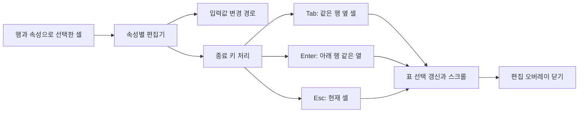

# Notion 셀 입력: REA 코드 추적과 Estate ERP 비교

2026-11-12. 현재 열린 Notion `작업 트래커 | 모든 작업`의 배포 JavaScript와 로컬 Estate ERP 소스를 비교했다. 이번에는 REA CLI 6.8.0의 실제 캡처·정적 분석을 실행했다. 제품 코드는 변경하지 않았다.

## 결론

Notion의 차이는 팝업 모양만이 아니다. **표의 선택 좌표, 속성별 편집기, 입력 중 변경 처리, 편집 종료 후 이동이 연결돼 있다.** 우리 앱은 표 선택과 편집기 포커스가 분리되어 있고, 초안 종료를 저장 요청 직후 또는 바깥 클릭에 연결한다. 이를 먼저 정리해야 비슷한 입력감을 낼 수 있다.

| 항목 | Notion에서 확인한 구조 | 현재 ERP | 우선 적용 방향 |
|---|---|---|---|
| 선택·편집 | 행/속성으로 원래 셀을 찾아 표 선택 모델에 복귀 | 표의 `{row,col}`와 편집기의 `{recordId,field}`가 별도 | 안정적인 셀 ID로 선택·편집·복귀 연결 |
| Enter / Tab / Esc | 편집 중 Enter는 아래 셀, Tab은 옆 셀, Esc는 현재 셀 선택으로 복귀 | 표 Enter는 상세 열기; 편집기 Tab은 문서 내 버튼 순회 | 편집 진입과 종료 후 표 이동 계약 통일 |
| 텍스트 변경 | 입력 mutation마다 undo 가능한 로컬 트랜잭션 | Enter/Tab에 저장 요청, 바깥 클릭은 초안 폐기 | 메모의 저장·취소 정책 명시, 실패 초안 보존 |
| 상태 | 현재 값, 검색어, 키보드 후보가 별도 | 매물상태의 현재 값 연결이 빠짐 | 현재 값 연결 수정 + 별도 방향키 후보 표시 |
| 숫자 | 입력 원문·파싱 값·유효성 상태를 구분 | `Number(draft)` 결과를 저장 경로에 전달 | 만원 기준 유한수 검증, invalid와 빈 값 분리 |
| 편집창 | 셀 위치·문자 스타일 유지, 속성별 크기, 데스크톱 확대/페이드 방지 | 메모도 한 줄 input, 셀보다 넓고 강한 그림자 | 여러 줄 메모, 자동 높이, 원래 문자 위치 유지 |

## 1. 실제로 실행한 REA 분석

대상은 CDP `127.0.0.1:9333`의 target `B7F731F4880E79737C3DB6B8E77AE69E`다. 제목과 URL을 다시 조회하고 현재 페이지를 캡처했다. 과거 영어 Tasks Tracker의 결과를 현재 페이지의 증거로 대체하지 않았다.

모든 원본·완전한 Evidence·정리본은 [분석 폴더](/Users/hyunsulee/Downloads/notion-cell-rea-20261112)에 있다.

| 작업 | 결과 / Evidence |
|---|---|
| `list-browser-targets`, `inspect-web-page` | 현재 renderer와 로드된 스크립트 목록 확보. `ev_fbc40c538d82e795c88a8f56009bb3a8f7fa72cec47e0f35283c9906ad2fe297` |
| `export-web-scripts` | 캡처에 포함된 스크립트를 `scripts/`로 내보냄 |
| Router 관련 원본 2개 정적 분석 | `89957…`, `BlockPropertyRouter…`; 204,047 bytes, parse 실패 0. `ev_1d73d9591ab38dbae204f99e0c83ce1d4d03cf0891e3f1f6e90d0e4dc9574ab1` |
| 실제 편집기 원본 정적 분석 | `97086-8564ae5d7a9e7736.js`; 194,213 bytes, parse 실패 0. `ev_ae9ee7e24215dd82f6f037d3158874251911a45a0a4bbe8e2a933f13f2c19159` |
| 공통 편집기·store AST 발췌 5개 분석 | 43,910 bytes. 원본 범위와 SHA는 `selected-modules/provenance.json`. `ev_a6640cb921d85732cbea49db9228c23c60a3c6f598d20fb2283abdee8cc55baa` |
| 메뉴·숫자 파서 발췌 3개 + 표 키보드 원본 분석 | 32,083 bytes. `control-modules/provenance.json`. `ev_a873dc3c7c394f637159fc81cc180cae2a317b6c3bdc9ded21174f5003e01a7f` |

캡처의 합산 소스 예산 때문에 449개 스크립트 본문이 빠져 있었다. 그중 실제 셀 편집기가 포함되어 있어, 같은 renderer의 `Debugger.getScriptSource`로 누락된 소스를 보완했다. **449개 모두 REA가 기록한 `cdp_hash`와 SHA-256이 일치**했다. 이 추가 취득은 직접 CDP 작업이고, 취득한 핵심 번들에 REA 정적 분석을 별도로 실행했다. [취득·해시 근거](/Users/hyunsulee/Downloads/notion-cell-rea-20261112/supplemental-scripts-provenance.json)

`readable/`는 배포된 minified JavaScript를 Prettier로 포맷한 것이다. Notion의 원래 TypeScript/React 소스를 복원했다고 주장하지 않는다. AST 발췌는 원본 ObjectMethod 범위에 합성 객체 wrapper를 붙인 것으로, 원본 Rspack 묶음과 동일한 모듈 연결을 전부 재구성하지 못한다.

**분석 한계도 남는다.** 큰 원본 두 파일은 semantic node 보존 한도에 도달했다. 선택하지 않은 의존성은 자동 분석되지 않는다. `trace-application-feature`에 정확한 `BlockPropertyValueOverlay.handleTextChange` 문자열을 넣었지만 graph에서는 `no-match`였다(`ev_069d3d24853a3b0d8c45fbc42c41eedf653d047d32749ea6a90ede6776f0fc2a`). 아래 호출 흐름은 그 자동 trace가 완성한 결과가 아니라, REA의 원본 식별·정적 결과와 **동일한 배포 소스의 콜백/함수 본문을 직접 대조한 코드 추적**이다. 문자열이 graph에 없다고 실제 코드에 없다는 뜻은 아니다.

## 2. 표 선택과 편집 종료가 연결되는 방식

- `BlockPropertyRouter`는 `onTab/onUntab/onEnter/onEsc/onBgClick`과 행 store·속성을 등록한다. [Router 코드](/Users/hyunsulee/Downloads/notion-cell-rea-20261112/readable/89957-514b1cd9e2075357.js:5855)
- overlay 공통 함수는 `findBlockPropertyValue(store, property)`로 그 셀을 찾아 콜백에 돌려준다. 문서 전체 input/button 순서를 다음 셀로 취급하지 않는다. [공통 연결](/Users/hyunsulee/Downloads/notion-cell-rea-20261112/readable/576186.js:297)
- 표의 콜백은 현재 표시 열, 전체 행, 선택 좌표, 고정 열, 스크롤 정보를 전달한다. [Table 연결](/Users/hyunsulee/Downloads/notion-cell-rea-20261112/readable/CollectionViewBlock-af3800c78cd8b2e9.js:28370)
- `handlePropertyTabOrUntab`는 같은 행에서 열을 ±1 한다. 이 경로에서 마지막 열은 마지막 열에 머물며 자동으로 다음 행 첫 열로 감기지 않는다. Enter는 행+1, Esc/바깥 닫기는 현재 셀 좌표를 선택한 뒤 오버레이를 닫는다. [실제 이동 함수](/Users/hyunsulee/Downloads/notion-cell-rea-20261112/readable/tableSelectionOverlayPropertyActions-33d4d456dc1ce572.js:6)

이번 실제 화면 재검증에서도 변경하지 않은 제목에서 Tab을 누르면 오른쪽 상태 셀이 선택되고, 제목 편집 중 Enter를 누르면 다음 행의 제목이 선택됐다. [Enter 후 화면](/Users/hyunsulee/Downloads/notion-cell-rea-20261112/runtime/title-enter-moves-down.png), [Tab 후 화면](/Users/hyunsulee/Downloads/notion-cell-rea-20261112/runtime/04-title-tab.png)

ERP는 [표 선택](/Users/hyunsulee/estate-erp/apps/desktop/src/renderer/routes/_authenticated/properties/-components/property-listings-table.tsx:135)과 [편집 상태](/Users/hyunsulee/estate-erp/apps/desktop/src/renderer/components/data-table/cell-editor.tsx:57)가 따로다. 편집 버튼의 `stopPropagation`으로 표 선택이 갱신되지 않는다. 편집 종료 후 [문서 전체 편집 버튼을 순회](/Users/hyunsulee/estate-erp/apps/desktop/src/renderer/components/data-table/cell-editor.tsx:227)하며, 버튼에 포커스가 가면 표의 방향키 핸들러는 그 이벤트를 무시한다. 기존 ‘동 셀에 파란 테두리가 남은 채 다른 행 메모 편집’ 관측을 설명하는 경로다.

## 3. 텍스트는 Esc를 누르기 전부터 변경 경로에 들어간다

제목과 설명은 공통 RichText 편집기 `602430.A`를 사용한다. 제목은 스타일 주석을 제한하고 설명은 허용한다. 설명에는 목록 들여쓰기와 Enter 처리 등 별도 규칙도 있어 모든 속성을 같은 input 하나로 취급하지 않는다. [제목](/Users/hyunsulee/Downloads/notion-cell-rea-20261112/readable/97086-8564ae5d7a9e7736.js:6079), [설명](/Users/hyunsulee/Downloads/notion-cell-rea-20261112/readable/97086-8564ae5d7a9e7736.js:6204)

`Text.handleMutation`은 입력 변화에서 `createAndCommit({canUndo:true})`를 만들고 `414436.kE`로 새 내용을 전달한다. 조합 입력 여부도 같이 넘긴다. 이는 로컬 모델 변경 경로이며, 매 키마다 서버 저장이 완료된다는 뜻은 아니다. [텍스트 mutation](/Users/hyunsulee/Downloads/notion-cell-rea-20261112/readable/602430.js:1124)

overlay가 가진 `clonedStore`라는 이름만 보고 별도 취소 가능한 초안으로 해석하면 안 된다. 일반 `clone()`은 같은 pointer와 `inMemoryRecordCache`를 사용한다. 임시 cache를 따로 만드는 `bulkDraftStore`는 일괄 편집 분기다. Esc의 discard 표시도 bulk draft가 있을 때만 작동한다. [clone 구현](/Users/hyunsulee/Downloads/notion-cell-rea-20261112/readable/359990.js:3), [일반·bulk 분기](/Users/hyunsulee/Downloads/notion-cell-rea-20261112/readable/576186.js:112)

따라서 **일반 텍스트 셀에서 Esc는 편집 종료이며, 입력 전체를 초기 값으로 돌리는 함수로 연결되어 있지 않다.** 일괄 편집과 새 빈 행 삭제 같은 특수 경로는 다르다. 실제 값을 바꾼 뒤 Esc/Undo를 시험하지 않았으므로 이 결론은 코드 경로에 대한 판단이다.

ERP는 바깥 클릭 → `onCancel(false)` → `stopEdit()` → 초안 Map 삭제다. Enter/Tab은 `onSave()`의 동기 반환 직후 편집기를 닫는다. 실제 callback은 `mutation.mutate()`이므로 서버 응답 전에 초안이 지워지고, 실패 시 toast/재조회만 남는다. [닫기·저장 계약](/Users/hyunsulee/estate-erp/apps/desktop/src/renderer/components/data-table/cell-editor.tsx:300), [바깥 클릭](/Users/hyunsulee/estate-erp/apps/desktop/src/renderer/components/data-table/cell-editor.tsx:490), [메모 mutation](/Users/hyunsulee/estate-erp/apps/desktop/src/renderer/routes/_authenticated/properties/index.tsx:957)

ERP에는 가상화 재마운트 초안 복원, IME Enter 가드, `expectedUpdatedAt` 충돌 방지가 이미 있다. 이를 유지하면서 저장 중 값과 실패 초안을 남길 필요가 있다. Notion의 즉시 변경만 가져오고 Undo/복구 구조를 빠뜨리는 것은 같은 동작을 구현하는 것이 아니다.

## 4. 현재 상태와 키보드 후보를 구분한다

Notion의 상태 편집기는 세 상태를 나눈다.

1. **현재 값**: 원래 `Done`을 상단 칩으로 보여 준다.
2. **검색어**: `진행`을 입력하면 후보만 줄어든다. 저장된 상태는 바뀌지 않는다.
3. **키보드 후보**: 방향키로 움직이는 배경 강조다. Enter 또는 클릭으로 확정할 때 변경 경로가 실행된다.

현재 값과 검색어는 별도 state이고, 옵션의 focus는 공통 MenuList가 제공한다. MenuList는 방향키/hover와 확정을 구분한다. 선택하면 값 변경 트랜잭션을 만들고, 다음 flush 후 키보드 확정은 셀의 Enter 경로, 마우스 확정은 현재 셀로 돌아가는 경로를 사용한다. [현재 값·검색](/Users/hyunsulee/Downloads/notion-cell-rea-20261112/readable/97086-8564ae5d7a9e7736.js:3110), [확정 후 처리](/Users/hyunsulee/Downloads/notion-cell-rea-20261112/readable/97086-8564ae5d7a9e7736.js:7644)

**ERP에서 새로 확인한 결함:** `select-chip`의 초기값은 `chipValueOf?.(value) ?? ''`인데 매물상태 호출부는 `chipValueOf`를 넘기지 않는다. 실제 ‘종료 · 우리 거래’ 셀에서 팝업을 열었을 때 선택 표시가 없고 첫 ‘활성’ 버튼에 포커스했다. 값은 선택하지 않고 Esc로 닫았다. [초기값](/Users/hyunsulee/estate-erp/apps/desktop/src/renderer/components/data-table/cell-editor.tsx:370), [호출부](/Users/hyunsulee/estate-erp/apps/desktop/src/renderer/routes/_authenticated/properties/index.tsx:5300), [실제 화면](/Users/hyunsulee/Downloads/notion-cell-rea-20261112/estate-status-no-current-value.png)

앞선 비교에서 ‘현재 값 표시가 이미 있다’고 한 설명을 정정한다. 공통 컴포넌트는 지원하지만 실제 매물상태와의 연결은 빠져 있다. 날짜형 입주가능일은 별도 adapter를 전달하므로 모든 선택기에 같은 결함이 있는 것은 아니다.

상태 네 개에 Notion의 검색·그룹 편집 전체를 가져올 필요는 없다. 현재 값 표시와 방향키 후보 구분이 핵심이다. 매물상태는 거래/의뢰로부터 파생되므로 기존 거래 종료·재활성 확인 절차는 유지해야 한다.

## 5. 금액은 입력 원문과 저장 값을 분리해야 한다

Notion의 숫자 편집기는 원문 문자열, 파싱된 값, invalid 상태를 구분한다. 숫자 prop이 바뀔 때마다 입력 중인 원문을 다시 포맷하지 않고, 각 입력에서 파싱 결과와 invalid 여부를 별도 콜백으로 전달한다. [숫자 편집기](/Users/hyunsulee/Downloads/notion-cell-rea-20261112/readable/97086-8564ae5d7a9e7736.js:4722)

다만 Notion의 숫자 처리도 그대로 복제할 대상은 아니다. 파서는 지역별 구분자·분수·일부 문자열 정리를 지원하며 Infinity도 허용한다. 일반 단일 셀에서 잘못된 입력은 모델의 빈 값으로 인코딩되는 경로가 있고, 오류 알림은 편집기 unmount 때 발생한다. 일괄 편집의 invalid 처리와도 다르다. 이 분기는 실제 숫자 셀에 값을 저장해서 시험하지 않았다.

ERP는 `Number(draft)`를 사용하므로 `1,000` 같은 문자열이 NaN이 될 수 있다. 가격 경로에서 이를 거부하지 않으면 JSON 직렬화에서 `null`이 된다. 보증금·월세·융자금의 다른 파서도 invalid를 `null`로 바꾼다. **잘못된 입력과 사용자가 의도한 값 비우기를 구분하지 못하는 코드 경로**가 있다. 실제 매물값을 변경해 검증하지 않았다. [공통 파서](/Users/hyunsulee/estate-erp/apps/desktop/src/renderer/components/data-table/cell-editor.tsx:512), [가격 전달](/Users/hyunsulee/estate-erp/apps/desktop/src/renderer/routes/_authenticated/properties/index.tsx:5540), [API 직렬화](/Users/hyunsulee/estate-erp/packages/api-client/src/client.ts:70)

적용 시 `rawText`, `parsedValue`, `validationError`를 구분하고, 허용 표기와 만원 단위를 명시해야 한다. 유효하지 않은 숫자는 원문을 유지하고 저장을 막아야 하며, 빈 문자열일 때만 명시적으로 비우기를 처리하는 방향이 적절하다.

## 6. 편집창이 셀에서 자연스럽게 이어지는 이유

Notion overlay는 셀 rect를 기반으로 top/left를 약 1px 보정하고 속성별 너비를 선택한다. 일반 편집기는 셀 높이를 최소 높이로 삼고 화면 높이 안에서 확장한다. 데스크톱 popup에는 `preventScaleTransition`과 `preventOpacityTransition`이 켜져 있어 입력 시작에 확대/페이드를 기다리지 않게 한다. [배치와 전환](/Users/hyunsulee/Downloads/notion-cell-rea-20261112/readable/97086-8564ae5d7a9e7736.js:5832)

실제 제목 편집은 글자 14px/줄 높이 21px, 외곽 276×38px, radius 6이었다. 긴 설명은 두 줄 높이로 펼쳐졌고 행을 밀지 않았다. ERP도 portal 구조는 있으나 메모에 한 줄 input을 사용하며 셀보다 12px 넓고 그림자가 강하다. 먼저 폰트·줄 높이·문자 시작점을 표시 상태와 맞추고, 메모만 자동 높이 textarea로 바꾸는 것이 적절하다.

## 검증 범위와 다음 구현 순서

이번 Electron 확인에는 `electron` skill과 agent-browser를 사용해 실제 ERP의 상태 팝업을 조작하고 캡처했다. Notion의 REA `capture-browser-scenario`는 browser WebSocket handshake 단계에서 실패했고 transport cleanup 불확실성을 반환했다. CLI가 종료한 뒤 실제 renderer를 직접 CDP로 확인했다. REA가 제목 클릭을 성공적으로 수행했다고 기록하지 않는다. 직접 CDP로 값 변경 없는 제목 클릭/Esc/Enter/Tab 흐름을 재검증했으며, 마지막에 dialog 0개와 기존 세 행 값을 확인했다. [최종 상태](/Users/hyunsulee/Downloads/notion-cell-rea-20261112/runtime/final-notion-values.json)

| 질문 | 완료 수준 |
|---|---|
| 편집 진입과 오버레이 모양 | 코드 + 실제 화면 확인 |
| Enter/Tab/Esc 후 셀 이동 | 코드 + 변경 없는 입력으로 화면 확인 |
| 상태 현재 값 연결 누락 | ERP 코드 + 실제 화면 재현 |
| 텍스트 변경·Esc/바깥 닫기의 의미 | 배포 코드 추적; 변경한 값으로 live 실험하지 않음 |
| 상태 확정·숫자 invalid 처리 | 배포 코드 추적; 실제 저장하지 않음 |
| 서버 저장 성공/실패·Undo·한글 IME | 관련 코드 일부 확인; live 실험 미실시 |

구현 우선순위는 **① 상태 현재 값·숫자 invalid 처리 → ② 표 선택/편집/키보드 복귀 통합 → ③ 저장 중·실패 초안 복원 → ④ 여러 줄 메모와 배치·그림자 정리**다. 이 문서의 방향은 제안이며 아직 구현하지 않았다.

세부 근거: [ERP 소스 감사](/Users/hyunsulee/Downloads/notion-cell-rea-20261112/erp-source-audit.md), [Notion 상태·숫자 감사](/Users/hyunsulee/Downloads/notion-cell-rea-20261112/status-source-audit.md), [이전 화면 비교](./notion-cell-editing.md).
